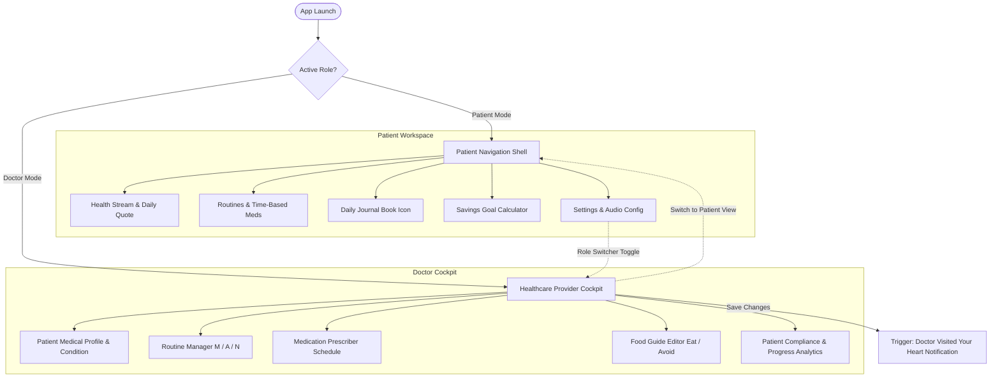
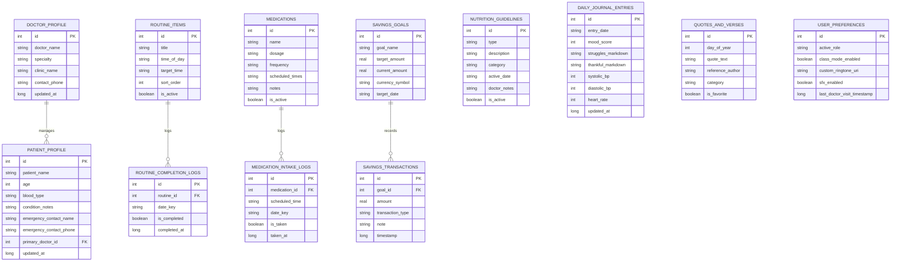
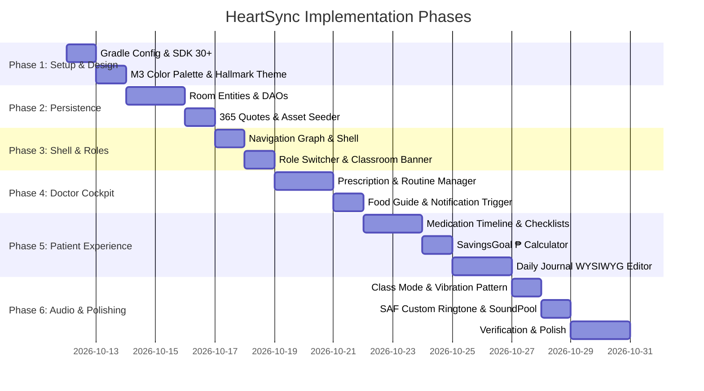

# HeartSync: Comprehensive Architectural Implementation Plan
**Offline Cardiac Care & Health Tracking Application for Students**
*Target Platform: Android 11+ (API 30+) | Architecture: Kotlin, Android Jetpack, Room SQLite, Material Design 3*

---

## 1. Executive Summary & Product Vision

### 1.1 Purpose & Problem Statement
HeartSync is a dedicated offline mobile health platform designed specifically for students and young individuals managing chronic heart conditions (such as Supraventricular Tachycardia, Arrhythmias, Rheumatic Heart Disease, Congenital Heart Defects, and Hypertension). Managing cardiac health while balancing academic pressures, classes, and exams creates unique challenges:
1. Students need discreet, non-disruptive medication reminders during lectures and study periods.
2. Students face financial anxiety regarding maintenance medication costs and diagnostic consultations.
3. Healthcare providers need an intuitive, friction-free way to configure medical directives without requiring cloud infrastructure, servers, or internet connectivity.

### 1.2 The Shared-Device Offline Model
In practical community healthcare and school clinic environments, internet access may be intermittent or nonexistent. HeartSync operates under a shared-device paradigm:
- The app resides on the patient's smartphone.
- During consultations, the attending healthcare provider (doctor, cardiologist, or school clinic nurse) uses the patient's phone directly to inspect compliance, update prescriptions, schedule routines, and set dietary boundaries.
- No external authentication servers, cloud tokens, or complex Role-Based Access Control (RBAC) are required. The interface features a streamlined role switch between **Patient View** and **Doctor View**, adhering strictly to the **KISS** (Keep It Simple, Stupid) and **YAGNI** (You Aren't Gonna Need It) engineering principles.

### 1.3 Key Functional Pillars
- **Google Classroom Dual Interface**: A unified navigation model where the doctor acts as the instructor defining health directives, and the student acts as the learner executing and tracking compliance.
- **Hallmark Anti-AI-Slop Visual Design**: A clean, intentional aesthetic avoiding redundant labels, fake badges, and generic templates.
- **Time-Blocked Routines & Medication Timeline**: Morning, Afternoon, and Night routines paired with exact time-based medication reminders.
- **Dietary Guidance Matrix**: Clear distinction between heart-healthy foods and high-sodium/caffeine cardiac triggers.
- **Doctor Visit Notification**: An automatic notification posted whenever the healthcare provider updates the patient's records ("Doctor [Name] visited your heart! Want to check your progress?").
- **Daily Journal with Notion/Tiptap Block Minimalism**: A reflective mental wellness canvas capturing daily struggles and gratitude using offline rich text editing.
- **SavingsGoal Calculator**: A medical expense buffer calculator in Philippine Pesos (₱) to gamify healthy choices and track medication funds.
- **Class Mode & Custom Audio System**: A silent vibration override for classroom settings and Storage Access Framework (SAF) custom ringtone support for alarms.
- **Deterministic 365 Daily Quotes & Bible Verses**: A pre-seeded local SQLite repository delivering daily morning encouragement without network requests.

---

## 2. Hallmark Anti-AI-Slop UI/UX & Design Architecture

### 2.1 Hallmark Anti-AI-Slop Principles
HeartSync implements the Hallmark design philosophy from `skill.sh` to ensure the application feels purposefully crafted, tactile, and clinically trustworthy:

1. **Elimination of Redundant Signposting**: Avoid obvious, repetitive headers. For example, never place an `H1` "Home" accompanied by "Welcome to your home page". If the user is on the routine screen, the active time-of-day card speaks for itself.
2. **Dense Spatial Rhythm**: Reject equal-sized generic cards stacked uniformly. Primary active routines dominate the immediate viewport, while completed or distant tasks collapse into compact, tactile data strips.
3. **Tactile Physicality**: Every interactive button, pill, or card features distinct visual feedback across all states (Default, Pressed with a 2dp scale dip, Focused, and Completed).
4. **Authentic Copy & Data**: Avoid fabricated statistics, vague badges, or cartoon illustrations. Every metric reflects true clinical numbers (milligrams, blood pressure in mmHg, heart rate in BPM, and savings in ₱).
5. **No Emojis as Structural Icons**: Rely exclusively on Material Design vector symbols drawn with consistent stroke weights.

### 2.2 Color System & Semantic Palette
The color scheme is rooted in **Cardiac Crimson, Rose Pulse Pink, Crisp Surgical White, and Deep Anchor Navy**:

| Semantic Token | Hex Code | Material 3 Mapping | Clinical & UI Usage |
| :--- | :--- | :--- | :--- |
| `Cardiac Crimson 900` | `#8A0014` | Primary Dark / On-Container | Warning headers, alert text, severe sodium warnings |
| `Cardiac Crimson 600` | `#BA1A2E` | Primary | Primary buttons, urgent vital alerts, active timeline nodes |
| `Cardiac Crimson 400` | `#DE374A` | Secondary Accent | Heart rate badges, active pulse indicators |
| `Rose Pulse 300` | `#FF8FA3` | Secondary / Dark Primary | Soft highlights, night-mode primary accents |
| `Rose Pulse 100` | `#FDE8EC` | Secondary Container | Morning routine card container, medication pill cards |
| `Rose Pulse 50` | `#FFF1F4` | Primary Container | Active routine highlight fill, struggles callout box |
| `Deep Anchor Navy 900` | `#0A1128` | Tertiary / On-Background | Deep text typography, clinical headers, dark surface |
| `Deep Anchor Navy 800` | `#1C2541` | Tertiary Container | Google Classroom hero banner, Doctor Mode cockpit fill |
| `Deep Anchor Navy 600` | `#3A506B` | Outline / Neutral Variant | Muted dates, subtitle text, inactive timeline rails |
| `Deep Anchor Navy 100` | `#E8EEF5` | Surface Variant | Gratitude callout fill, timeline connector lines |
| `Surgical Crisp White` | `#FFFFFF` | Surface | Clean elevated cards, dialog surfaces, bottom sheets |
| `Paper Warm White` | `#FBFBFC` | Background | Base application canvas background |
| `Vitality Mint` | `#059669` | Success | Completed routine tick marks, healthy food badges |
| `Warning Amber` | `#D97706` | Warning | Refill reminders, pending prescription notices |

### 2.3 Typography & Spatial Layout
- **Display Numerics**: Bold tabular figures (32sp / -0.5sp tracking) for vital signs (BPM, mmHg) and currency (₱) to eliminate visual jitter during real-time updates.
- **Section Headers**: Compact headline small (18sp - 20sp, weight 600) without redundant subheadings.
- **Body & Clinical Instructions**: Highly readable sans-serif (14sp - 15sp, line-height 22sp) for doctor notes and reflection journaling.
- **8-Point Spacing Grid**: Increments of 4dp, 8dp, 16dp, and 24dp for all layout paddings. Card corner radii standardized at 16dp.

---

## 3. Navigation & Screen Flow Architecture

### 3.1 Dual Interface Navigation Concept
HeartSync organizes navigation into two primary modes inspired by the Google Classroom model:



### 3.2 Screen Breakdown

#### 3.2.1 Patient Interface
1. **Health Stream (Home)**:
   - Google Classroom-style hero card in Deep Anchor Navy (`#0A1128`) featuring patient name, primary condition, and daily adherence percentage.
   - Daily Quote card greeting the student upon opening the app (updated every midnight).
   - "Doctor Visit" banner if recent modifications occurred.
   - Quick Emergency Call shortcut for cardiology contact.
2. **Routines & Medications**:
   - Progressive disclosure routine cards: Morning (06:00 - 11:59), Afternoon (12:00 - 17:59), and Night (18:00 - 23:59).
   - Vertical medication timeline node layout with time, dosage, pill visual icon, and tactile "Confirm Taken" toggle.
3. **Daily Journal (Book Icon)**:
   - Calendar date picker selector.
   - Cardiac symptom check selector (Smooth, Occasional Flutters, Tachycardia, Dizziness).
   - "Today's Struggles" rich text block.
   - "Grateful & Thankful For" rich text block.
   - Formatting toolbar (Bold, Italic, Underline, Bullet/Numbered lists, Undo/Redo).
4. **Savings Goal**:
   - Interactive financial gauge with default ₱500 goal.
   - Quick increment/decrement buttons (-₱100, -₱50, +₱50, +₱100, +₱500).
   - Savings breakdown log (e.g., "Generic Medicine Swap", "Skipped Cafeteria Soda").
5. **Settings & Audio**:
   - Class Mode toggle with blackboard/nested rectangle icon.
   - Custom Ringtone file picker via Storage Access Framework (SAF).
   - SoundPool UI sound effects toggle.
   - Role switcher to Doctor Mode.

#### 3.2.2 Healthcare Provider Interface (Doctor Cockpit)
1. **Patient Profile & Condition Editor**: Form to edit diagnosis (e.g., SVT, Hypertension), target blood pressure/heart rate ranges, emergency contacts, and clinical instructions.
2. **Routine Manager**: Form to configure Morning, Afternoon, and Night mandatory tasks (e.g., "Measure resting pulse", "15-minute gentle walk").
3. **Meds Prescriber**: Interface to add/edit medications with dosage, frequency, and exact notification times (e.g., 08:00 AM, 08:00 PM).
4. **Food Guide Editor**: Categorized dietary manager to add items to "Foods to Eat (Today)" and "Foods to Avoid (Today)", complete with sodium warnings.
5. **Compliance & Progress Analytics**: Adherence summary showing weekly checklist completion rates and medication intake timestamps.

---

## 4. Component CRUD Capability Matrix

To balance clinical safety and user autonomy while adhering to KISS and YAGNI, the CRUD permissions for each role are strictly defined:

| Feature / Component | Doctor CRUD Capabilities | Patient CRUD Capabilities | Rationale & Behavioral Rules |
| :--- | :--- | :--- | :--- |
| **Patient Profile & Diagnosis** | **Create / Read / Update** diagnosis, clinical notes, target vitals. | **Read** diagnosis and doctor notes. **Update** emergency contacts only. | Patients must not alter their clinical diagnosis or doctor-mandated vital targets. |
| **Medication Prescriptions** | **Create / Read / Update / Delete** medications, dosages, and times. | **Read** medication list and instructions. *(No create/update/delete)* | Pharmacological safety: Only the healthcare provider configures drug schedules. |
| **Medication Intake Logs** | **Read** full adherence history and intake timestamps. | **Create** intake log (mark as taken/skipped). **Update** within current day. | Patients record intake ground truth. Doctors review adherence analytics. |
| **Daily Routine Items** | **Create / Read / Update / Delete** Morning, Afternoon, Night tasks. | **Read** assigned routines. *(Optional: Add custom personal habit)*. | Clinician sets the therapeutic regimen; patient executes daily. |
| **Routine Completion Logs** | **Read** routine compliance stats. | **Create** completion tick. **Update** undo tick within same day. | Immediate tactile recording of daily physical routines. |
| **Food Guidance (Eat / Avoid)** | **Create / Read / Update / Delete** food directives and sodium limits. | **Read** daily recommended and prohibited foods. | Dietary advice for heart conditions requires clinical oversight. |
| **Daily Journal (Struggles/Thanks)**| **No Access** (or read aggregated mood only if permitted). | **Create / Read / Update / Delete** all personal journal entries. | Absolute patient privacy for emotional reflections and mental health notes. |
| **Savings Goal & Expense Logs** | **No Access** / Not applicable. | **Create / Read / Update / Delete** goals, amounts (₱), and logs. | Personal financial motivation tool managed entirely by the student. |
| **Quotes & Verses Repository** | **Read** daily inspirational scripture. | **Read** quote of the day. **Update** bookmark favorite status. | Static 365-day offline repository seeded at app launch. |
| **Class Mode & Custom Ringtone** | **No Access** / Not applicable. | **Read / Update** audio preferences, SAF custom ringtone, Class Mode. | Device-level audio and sensory settings controlled by the device owner. |

---

## 5. Database & Local Persistence Architecture (Room SQLite)

### 5.1 Architecture Overview
HeartSync utilizes Android Room over SQLite. All tables reside in an offline database file (`heartsync_offline.db`). No cloud sync or network serialization is involved.



### 5.2 Offline Pre-Population & Seeding Strategy
On initial database creation (`RoomDatabase.Callback.onCreate`), a coroutine populates the local SQLite store:
1. **User Preferences Singleton**: Defaults to `active_role = PATIENT`, `class_mode_enabled = false`, `sfx_enabled = true`.
2. **Default Doctor & Patient Profiles**: Pre-populates default cardiology contact information and initial patient condition notes.
3. **Core Daily Routines**:
   - Morning: "Baseline Blood Pressure Check" & "10-minute Post-Breakfast Cardio Walk".
   - Afternoon: "Hydration Check (500ml Water)" & "Midday Heart Rhythm Relaxation".
   - Night: "Evening Blood Pressure Check" & "Daily Journal Reflection".
4. **Initial Nutrition Matrix**:
   - Foods to Eat: High-potassium fruits (bananas, oranges), steamed fish, oats, leafy greens.
   - Foods to Avoid: Energy drinks, canned processed meats, instant ramen broths, high sodium fast foods.
5. **Initial Savings Goal**: Initialized to ₱500.00 titled "Health & Meds Buffer".
6. **365 Quotes & Bible Verses Dataset**: Imported from `assets/seed/quotes_365.json` (with programmatic fallbacks including *Philippians 4:13: "I can do all things through Christ who strengthens me"* and *Proverbs 4:23: "Above all else, guard your heart, for everything you do flows from it"*).

---

## 6. Daily Journal WYSIWYG Rich Text Integration

### 6.1 Library Selection: MohamedRejeb Compose Rich Editor
To achieve a Notion/Tiptap-like editing experience in Android 11+ without relying on heavy WebViews, HeartSync utilizes **`com.mohamedrejeb.richeditor:richeditor-compose`**:
- **Native Compose Implementation**: Zero web rendering engine overhead, instant cold start, no keyboard flickering.
- **Bi-Directional Markdown Support**: Content in the editor is exported directly as Markdown via `richTextState.toMarkdown()` and restored via `richTextState.setMarkdown()`. This allows rich styling to be stored compactly as text in Room SQLite.
- **Styling Controls**: Supports bold, italic, underline, strikethrough, heading levels 1-3, blockquotes, unordered bullet lists, ordered numbered lists, and full undo/redo history.

### 6.2 Dual-Section Architecture: Struggles & Gratitude
The journal screen renders two modular block containers:
1. **"Today's Struggles"**: Tinted in soft Crimson container (`#FFF1F4`) with warning accent icon, allowing students to record cardiac symptoms, academic anxiety, or fatigue.
2. **"Grateful & Thankful For"**: Tinted in calm Navy/Blue container (`#E8EEF5`) with heartbeat heart icon, encouraging positive reflection to lower cortisol and autonomic cardiac strain.
3. **Floating Formatting Toolbar**: A shared sticky toolbar that automatically binds to whichever block currently holds active cursor focus.

---

## 7. Event Triggers, Notifications, Class Mode & Audio System

### 7.1 "Doctor Visited Your Heart" Notification Trigger
Whenever the user is in Doctor Mode and saves any change to medications, routines, or nutrition guidelines:
1. The app records the current timestamp in `user_preferences.last_doctor_visit_timestamp`.
2. A system notification is immediately posted to the Android notification drawer:
   - **Title**: *"HeartSync Care Update"*
   - **Content**: *"Doctor [Name] visited your heart! Want to check your progress?"*
   - **Intent**: Tapping the notification automatically deep-links to the Patient Health Stream review screen.

### 7.2 Time-Critical Medication Alarms (AlarmManager)
- Cardiac medications require punctuality. Medication alerts are scheduled using Android `AlarmManager.setExactAndAllowWhileIdle()` to guarantee firing even during Android Doze mode.
- Android 12+ (API 31+) `SCHEDULE_EXACT_ALARM` permissions are handled with fallbacks.

### 7.3 Daily 12:00 AM Quote Dispatcher
- An `AlarmManager` or `PeriodicWorkRequest` fires daily at midnight.
- It computes the day of the year (`Calendar.DAY_OF_YEAR`), fetches the matching quote from `quotes_and_verses`, and posts a lock screen reminder so the student is greeted by inspiration when they first check their phone in the morning.

### 7.4 Class Mode: Vibration-Only Override
Students cannot have audible alarms interrupting lectures or study sessions.
1. **Visual Icon**: Classroom blackboard representation (nested rectangle within rectangle icon).
2. **Two Distinct Notification Channels (Android 11+ / API 30+)**:
   - `CHANNEL_STANDARD`: High importance, audible ringtone, vibration enabled.
   - `CHANNEL_CLASS_MODE`: High importance, sound explicitly set to `null`, vibration enabled with custom waveform pattern: `longArrayOf(0, 350, 150, 350, 150, 600)` (simulating a gentle cardiac lub-dub pulse).
3. When Class Mode is active, all alarm broadcasts dispatch exclusively to `CHANNEL_CLASS_MODE`.
4. All SoundPool UI sounds are silenced.

### 7.5 Custom Ringtones via Storage Access Framework (SAF)
In Settings, students can choose custom audio files (such as favorite songs or ringtones) for medication reminders:
- Launched via `ActivityResultContracts.OpenDocument()` with MIME type `audio/*`.
- HeartSync immediately secures persistable URI permission using `context.contentResolver.takePersistableUriPermission(uri, Intent.FLAG_GRANT_READ_URI_PERMISSION)`.
- If the file is moved or deleted, the player catches exceptions and falls back gracefully to `RingtoneManager.getDefaultUri(RingtoneManager.TYPE_ALARM)`.

### 7.6 Micro-Interaction SoundPool Audio & Haptics
Built-in low-latency UI feedback:
- `sfx_tap.ogg`: Crisp click on icon taps and routine checks.
- `sfx_heartbeat.ogg`: Subdued cardiac thud on saving vitals and logging medication.
- `sfx_success_chime.ogg`: Ascending chime on completing daily routines or reaching savings milestones.
- Haptics: `HapticFeedbackConstants.CLOCK_TICK` and `HapticFeedbackConstants.CONFIRM` for tactile button feel.

---

## 8. Technical Stack & Gradle Dependencies

### 8.1 Module Configuration
- **Minimum SDK**: `30` (Android 11.0 - Red Velvet Cake)
- **Target SDK**: `37` (Android 16+)
- **Compile SDK**: `37`
- **Language**: Kotlin 2.0+
- **UI Framework**: Jetpack Compose & Material 3 / ViewBinding

### 8.2 Dependency Manifest (`app/build.gradle.kts`)
```kotlin
// Room SQLite Database
implementation("androidx.room:room-runtime:2.7.0-alpha13")
implementation("androidx.room:room-ktx:2.7.0-alpha13")
ksp("androidx.room:room-compiler:2.7.0-alpha13")

// Lifecycle & ViewModel
implementation("androidx.lifecycle:lifecycle-viewmodel-ktx:2.8.7")
implementation("androidx.lifecycle:lifecycle-runtime-ktx:2.8.7")

// Navigation Component
implementation("androidx.navigation:navigation-fragment-ktx:2.8.5")
implementation("androidx.navigation:navigation-ui-ktx:2.8.5")

// Material Design 3
implementation("com.google.android.material:material:1.12.0")

// Notion-like Rich Text Editor (Compose)
implementation("com.mohamedrejeb.richeditor:richeditor-compose:1.0.0-rc10")

// WorkManager for Daily 12 AM Quote
implementation("androidx.work:work-runtime-ktx:2.10.0")

// Kotlin Serialization for JSON Seed
implementation("org.jetbrains.kotlinx:kotlinx-serialization-json:1.7.3")
```

---

## 9. Phased Step-by-Step Implementation Roadmap



### Phase 1: Foundation, Build Configuration & Hallmark Theme
1. Update `app/build.gradle.kts`: Set `minSdk = 30`, add Room, KSP, Material 3, Serialization, and RichEditor dependencies.
2. Define Material 3 color system tokens in `res/values/colors.xml` (Cardiac Crimson, Rose Pulse Pink, Surgical White, Deep Anchor Navy).
3. Define typography scales and tactile button styles adhering to Hallmark anti-slop rules in `res/values/themes.xml`.
4. Import vector drawables: Class Mode icon (rectangle within rectangle / blackboard), Book icon for journal, pill glyph, and heart cardiogram.

### Phase 2: Room SQLite Database & Offline Seeder
1. Implement Room entities: `DoctorProfileEntity`, `PatientProfileEntity`, `RoutineItemEntity`, `RoutineCompletionLogEntity`, `MedicationEntity`, `MedicationIntakeLogEntity`, `NutritionGuidelineEntity`, `DailyJournalEntryEntity`, `SavingsGoalEntity`, `SavingsTransactionEntity`, `QuoteOrVerseEntity`, `UserPreferencesEntity`.
2. Implement DAOs with Kotlin Coroutines and reactive `Flow` emissions.
3. Create `assets/seed/quotes_365.json` and build `HeartSyncDatabaseCallback` to seed the 365 daily quotes/Bible verses, default profiles, routines, and initial ₱500 savings goal.
4. Add bundled UI sound assets to `res/raw/` (`sfx_tap.ogg`, `sfx_heartbeat.ogg`, `sfx_success_chime.ogg`).

### Phase 3: Navigation Shell & Classroom Dual-Stream
1. Build top application chrome with active role badge, Class Mode quick toggle, and instant Role Switcher chip.
2. Build Google Classroom-inspired banner with cardiac status, doctor name, and adherence percentage.
3. Configure Navigation component graphs for Patient Mode and Doctor Mode.

### Phase 4: Healthcare Provider (Doctor) Management Features
1. Build Patient Medical Record & Diagnosis editor.
2. Build Routine Manager (Morning, Afternoon, Night time blocks).
3. Build Time-Based Medication Prescriber with hour/minute scheduling and dosage notes.
4. Build Food Guide Editor (categorized Foods to Eat vs Foods to Avoid with sodium warnings).
5. Implement `DoctorVisitNotificationManager` to post the notification (*"Doctor [Name] visited your heart! Want to check your progress?"*) upon saving changes.

### Phase 5: Patient Experience & Core Features
1. Build Routine adherence checklists with time-of-day progressive disclosure.
2. Build time-based medication railway timeline with pill visual cards and tactile confirmation toggles.
3. Build SavingsGoal calculator with default ₱500 goal, rapid increment/decrement buttons, progress gauge, and health savings expense log.
4. Build Daily Journal using `compose-rich-editor` with dedicated blocks for Struggles and Thankful For, plus mood rating chips.

### Phase 6: Class Mode, Custom Audio & Notifications
1. Implement `NotificationChannel` dual setup: `CHANNEL_STANDARD` and `CHANNEL_CLASS_MODE` (vibration-only).
2. Implement `MedicationAlarmScheduler` using `AlarmManager.setExactAndAllowWhileIdle()`.
3. Implement daily 12:00 AM quote notification worker.
4. Implement Storage Access Framework (SAF) custom audio picker with persistable URI permissions.
5. Implement low-latency `SoundEffectManager` with `SoundPool` silenced during Class Mode.

### Phase 7: Verification, Offline Testing & Delivery
1. Test offline behavior in Airplane mode to ensure zero network crashes.
2. Verify AlarmManager exact alarms on Android 11, 12, 13, and 14.
3. Verify Class Mode vibration pattern behavior.
4. Confirm database seed integrity and rich text Markdown serialization.

---
*Document produced for HeartSync Android Implementation. Ready for phase-by-phase execution.*
